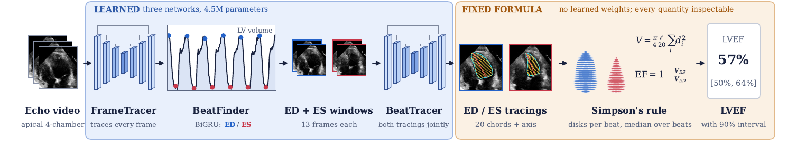

# SimpsonEF

**Explainable left-ventricular ejection fraction from predicted sonographer tracings and Simpson's rule.**

SimpsonEF computes LVEF the way a sonographer does. It draws the volume tracing (long axis and 20 chords) at end-diastole (ED)
and end-systole (ES) of every beat and applies Simpson's method of disks; the reported EF comes only from that formula.

**[Project page and in-browser demo](https://gowthamaanp.github.io/simpsonef/)** · [Paper (PDF)](docs/assets/simpsonef.pdf)



| | LVEF R² | MAE | Params |
|---|---|---|---|
| EchoNet-Dynamic TEST, all 1277 videos, no annotated frame (single plane) | 0.804 | 4.02 | 4.48M |
| Zero-shot CAMUS, 50 test patients (biplane, CAMUS convention) | 0.710 | 5.08 | |

## Run it on your own video

```bash
pip install -r requirements.txt
python run.py a4c.mp4 --out a4c_traced.mp4                     # single plane: apical 4-chamber, EF with a 90% interval
python run.py a4c.mp4 --biplane a2c.mp4 --out biplane.mp4      # biplane: apical 4- and 2-chamber of the same heart
```

`--out` writes the whole video with the tracing on every frame (translucent mask, outline, the 20 chords and the long axis),
the volume curve with every detected beat, and the EF; it may end in `.mp4` or `.gif`. On each beat's ED and ES frame the
tracing shown is the one Simpson's rule uses. `--json` saves the numbers. The networks expect a cropped apical view with the
sector filling the frame, as in EchoNet-Dynamic; other frame sizes are zero-padded to a square and resized to 112 × 112.

## Method

| Step | Code | Checkpoint |
|---|---|---|
| **FrameTracer** traces the 42 points (long axis and 20 chords) on every frame from a 13-frame window (offsets −24..24, step 4); width 24, 1.42M parameters | `src/frametracer.py` (`Tracer`) | `checkpoints/frametracer.pt` |
| **BeatFinder**, a 2-layer bidirectional GRU (0.53M) on FrameTracer's chords over time, marks ED and ES of every beat; it also predicts EF quantiles, used for the interval and for choosing its training epoch, never as the reported EF | `src/beatfinder.py` | `checkpoints/beatfinder.pt` |
| **BeatTracer** reads the 13-frame windows around a beat's ED and ES together (26 channels) and draws both tracings (84 points); width 32, 2.53M | `src/frametracer.py` (`Tracer`) | `checkpoints/beattracer.pt` |
| **Simpson's rule** per beat, median over beats; conformal 90% interval EF ± Q·s, s = (q95 − q05)/2 + \|EF − EF_BeatFinder\| | `src/simpson.py`, `src/pipeline.py` | `checkpoints/conformal.json` |

Both tracers are fully convolutional encoder–decoders (instance norm, GELU, skip connections, dilated bottleneck, no global
pooling) applied at scales 1, 1/2 and 1/4 with shared weights; the heatmap logits are fused by log-sum-exp and each point is the
soft-argmax over the 7 × 7 window at its peak. BeatTracer is averaged over 15 copies of its input (scales 0.85–1.17 × rotations
−8/0/8°). If BeatFinder pairs no ED with a later ES, the frames of largest and smallest FrameTracer volume are the beat.

**Single plane** (EchoNet-Dynamic labels): V = π/4 · L/20 · Σ dᵢ² with each phase's own long-axis length L, EF = 1 − V_ES/V_ED.
**Biplane** (CAMUS labels): one disk height for ED and ES, EF = 1 − Σ aᵢᴱˢ bᵢᴱˢ / Σ aᵢᴱᴰ bᵢᴱᴰ from the 4-chamber (a) and 2-chamber (b)
chord widths of FrameTracer's tracings (the tracer chosen on the CAMUS training patients); no interval is reported.

### Training (`scripts/train_tracer.py`, `scripts/train_beatfinder.py`)

| | FrameTracer | BeatTracer | BeatFinder |
|---|---|---|---|
| Loss | L1 points (1.5) + heatmap cross-entropy, σ 1.5 px (1.0) + L1 log(V+1) (1.06) + L1 ED→ES change of log(V+1) (4.0) + L1 log chord widths weighted by their share of V (2.0); ES frames weighted 1.25 | same, then an EF stage adding 40 · w_b · \|EF(P̂_ED, P̂_ES) − EF*\| in EF units, w_b ∝ (1 / TRAIN frequency of the label's EF bin)^0.5, bins <20, 20–29, …, 70–79, ≥80%, normalised to mean 1 | squared error of the ED / ES heatmaps against Gaussians (σ 1.5 frames) inside the annotated beat's window + pinball loss of the 5/50/95% EF quantiles |
| Augmentation | rotation ±20°, scale 0.8–1.2, shift ±18 px, frame rescaled 0.5–2.5× on its canvas, edge occlusion, scanner-style degradations | same without the scanner-style degradations | random temporal crop around the beat, feature noise SD 0.05 |
| Optimiser | AdamW, lr 3e-4, wd 1e-4, cosine, EMA 0.999, batch 32 frames, dropout 0.1, 40 epochs | the same 40 epochs (width 32), then 12 epochs at lr 1e-4, no dropout | AdamW, lr 1e-3, wd 1e-3, cosine, batch 32, dropout 0.2, 16 epochs |
| Checkpoint | lowest VAL log-volume + ED→ES error | pretraining: same; EF stage: highest VAL formula-EF R² | highest VAL R² of its EF output |

## Reproduce

```bash
# EchoNet-Dynamic in data/ (Videos/, FileList.csv, master.csv, VolumeTracings.csv, annotation/Masks/), CAMUS in data/camus/CAMUS_public
STAGES="eval" ./reproduce.sh      # evaluate the released checkpoints: VAL, conformal calibration on VAL, TEST, CAMUS
./reproduce.sh                    # rebuild all three networks with fixed seeds, then evaluate
```

`scripts/eval_echonet.py` and `scripts/eval_camus.py` call the same `src/pipeline.py` as `run.py`. Rebuilding BeatTracer from
scratch with another seed gives R² 0.816 on VAL and 0.799 on TEST.

The browser demo (`docs/`) runs the ONNX exports (`tools/export_onnx.py`) with ONNX Runtime Web, in single-plane and biplane
mode, and replays the whole clip with the tracings; `docs/js/pipeline.js` mirrors `src/pipeline.py` (check with
`tools/reference_ef.py`) but skips the 15-copy input averaging.

## Data

EchoNet-Dynamic and CAMUS are not included; obtain them from their providers under their terms.

## Licence

Code: MIT (`LICENSE`). Model weights: CC BY-NC 4.0, research use only, subject to the EchoNet-Dynamic research use agreement
(`MODEL_LICENSE.md`). Not a medical device.

## Citation

```bibtex
@misc{palani2026simpsonef,
  title        = {SimpsonEF: Explainable Ejection Fraction from Predicted Sonographer Tracings and Simpson's Rule},
  author       = {Palani, Gowthamaan and Krishnamurthi, Ganapathy},
  year         = {2026},
  howpublished = {\url{https://github.com/gowthamaanp/simpsonef}}
}
```
